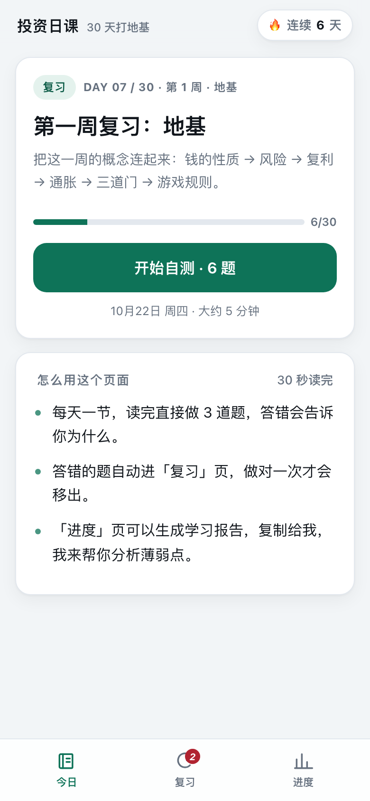
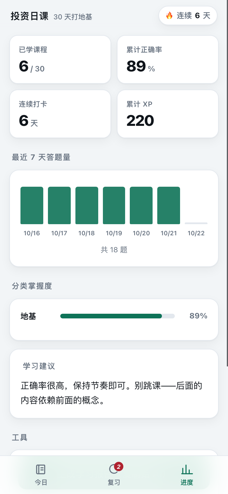
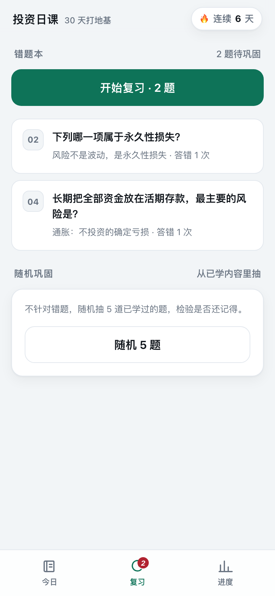

# 投资日课

一个给「全职上班、时间有限」的人用的投资学习网页：每天 1 张知识卡 + 3 道题，5 分钟，
答错的题自动进错题本，进度存在本地，可以一键生成学习报告交给 AI 做分析。

| 今日 | 进度 | 复习 |
| --- | --- | --- |
|  |  |  |


## 打开方式

**手机上直接打开（电脑关机也能用）：**

### https://sigh7788.github.io/

建议加到主屏幕：Safari 点「分享」→「添加到主屏幕」；Chrome 点右上角「⋮」→「添加到主屏幕」。
加完后全屏运行，跟原生 App 一样，断网也能打开（Service Worker 缓存）。

**本地开发用（可选）：**

```bash
./start.sh          # 启动本地服务，会打印局域网地址
```

本地模式比公网多一个能力：每次答题会把进度和报告写到 `data_store/progress.json` 和 `学习报告.md`，
AI 可以直接读。公网版没有后端，进度只存在浏览器里。

## 改完怎么发布

仓库就是站点根目录，推上去 GitHub Pages 会自动重新构建（约 1 分钟）：

```bash
git add -A && git commit -m "更新内容" && git push
```

想发布到别的静态托管（Netlify / Cloudflare Pages 等）：

```bash
./build.sh          # 生成 dist/，把它拖进托管平台即可
```

## 页面结构

| 页签 | 作用 |
| --- | --- |
| **今日** | 下一节未学的课程。读完知识卡 → 做 3 道题 → 立即看到对错和解析 → 打卡 |
| **复习** | 错题本（做对一次才移出）+ 从已学内容随机抽题巩固 |
| **进度** | 已学课数、正确率、连续打卡、XP、近 7 天答题量、分类掌握度、学习建议、生成报告 |

## 数据存在哪

**公网版（默认）**：进度存在手机浏览器的 localStorage，不上传任何服务器。
换设备时用「进度 → 导出进度」拿到 JSON，在新设备「导入进度」。

**本地版（跑 `./start.sh` 时）**：额外落盘两个文件，AI 可以直接读：

- `data_store/progress.json` —— 机器可读的完整进度
- `学习报告.md` —— 人类可读的学习报告

不管哪种模式，「进度 → 生成学习报告」都会把报告复制到剪贴板，
粘贴给 AI 就能做薄弱点分析。

## 课程内容

30 天，4 个阶段：

1. **第 1 周 · 地基**（第 1–7 天）：资产本质、风险与波动、复利、通胀、投资前的三道门、正和与零和
2. **第 2 周 · 工具与配置**（第 8–14 天）：资产配置、五类资产、指数基金、费率、场内/场外、最大回撤
3. **第 3 周 · A 股规则**（第 15–21 天）：交易规则、指数编制、估值分位、定投、再平衡、分红
4. **第 4 周 · 行为与风险**（第 22–30 天）：损失厌恶、过度交易、确认偏误、仓位管理、加密、宏观、IPS、结业复习

每周第 7 天和最后一天是复习日，自动从当周池子里抽 6 题。

## 想加内容怎么办

课程数据在 `data/week1.js` ~ `data/week4.js`，格式：

```js
{
  id: "d31", day: 31, week: 5, tag: "进阶",
  title: "标题",
  hook: "一句话导语",
  points: ["要点 1", "要点 2"],
  takeaway: "一句话记住",
  quiz: [
    { q: "题目", options: ["A", "B", "C", "D"], answer: 1, explain: "解析" }
  ]
}
```

新增文件后在 `index.html` 里加一行 `<script src="data/week5.js"></script>` 即可。
`answer` 是正确选项的下标（从 0 开始）。

30 天学完后，可以让我续写第二阶段（个股与财报、行业研究、宏观周期、加密进阶）。

## 常见问题

**公网地址打不开？**
GitHub Pages 偶尔会慢。先确认 `git push` 成功，再等 1–2 分钟；
还不行就去仓库的 Actions 标签页看 Pages 构建有没有失败。

**本地地址（局域网）打不开？**
1. 确认手机和电脑连的是同一个 WiFi（不是访客网络）。
2. 电脑防火墙可能拦了：系统设置 → 网络 → 防火墙 → 选项，允许 Python 接受连接。
3. 换端口启动：`PORT=9000 ./start.sh`。

**换了 WiFi，IP 变了？**
重新运行 `./start.sh`，会打印新的手机地址。

**进度会不会丢？**
进度同时存在浏览器 localStorage 和服务端的 `data_store/progress.json`。
清浏览器缓存也不会丢（下次打开会从服务端恢复）；换手机打开同一个地址也能接上。

**想重新开始？**
进度页最下方「重置所有进度」，或直接删掉 `data_store/` 和 `学习报告.md`。
